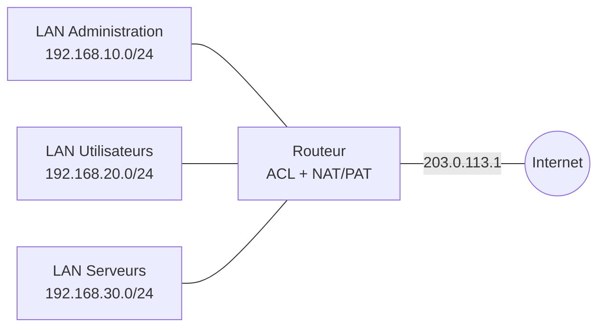

# 🛡️ Filtrage ACL et traduction d'adresses NAT/PAT

Configuration de **listes de contrôle d'accès (ACL)** pour autoriser ou bloquer des flux entre réseaux, et de la **traduction d'adresses (NAT/PAT)** pour permettre aux postes internes d'accéder à l'extérieur avec une seule adresse publique.

[⬅ Retour au portfolio](https://github.com/EvanBienvenu/EvanBienvenu)

## Contexte

Un réseau d'entreprise doit contrôler qui peut accéder à quoi : par exemple, seuls les postes de l'administration doivent joindre les serveurs. Il doit aussi permettre à tous les postes de sortir sur Internet, alors que l'entreprise ne dispose que d'une adresse IP publique.

## Objectifs

- Restreindre l'accès à un réseau de serveurs avec des ACL
- Autoriser uniquement certains services (par exemple le web)
- Partager une adresse publique entre tous les postes avec le PAT
- Rendre un serveur interne accessible depuis l'extérieur avec du NAT statique

## Topologie



<!-- À vérifier : remplacer les adresses et les règles par celles de la maquette réelle. -->

## Configuration

### ACL étendue : protéger les serveurs

```cisco
ip access-list extended PROTECTION-SERVEURS
 permit ip 192.168.10.0 0.0.0.255 192.168.30.0 0.0.0.255
 permit tcp 192.168.20.0 0.0.0.255 host 192.168.30.10 eq 80
 permit tcp 192.168.20.0 0.0.0.255 host 192.168.30.10 eq 443
 deny ip any 192.168.30.0 0.0.0.255
 permit ip any any
!
interface GigabitEthernet0/2
 ip access-group PROTECTION-SERVEURS out
```

### PAT : partager l'adresse publique

```cisco
access-list 1 permit 192.168.0.0 0.0.255.255
!
interface GigabitEthernet0/0
 ip nat inside
interface GigabitEthernet0/1
 ip nat inside
interface GigabitEthernet0/3
 ip address 203.0.113.1 255.255.255.252
 ip nat outside
!
ip nat inside source list 1 interface GigabitEthernet0/3 overload
```

### NAT statique : publier un serveur web

```cisco
ip nat inside source static tcp 192.168.30.10 80 203.0.113.1 80
```

## Tests et vérifications

| Test | Commande | Résultat attendu |
| --- | --- | --- |
| Règles et compteurs | `show access-lists` | Les compteurs augmentent selon le trafic |
| Accès autorisé | `ping` d'un poste Administration vers un serveur | Réponses reçues |
| Accès bloqué | `ping` d'un poste Utilisateurs vers un serveur | Échec (destination injoignable) |
| Accès web autorisé | Navigateur vers `http://192.168.30.10` | Page affichée |
| Traductions | `show ip nat translations` | Adresses internes traduites |

## Ce que j'ai appris

- L'ordre des règles d'une ACL compte : la première règle qui correspond s'applique
- Une ACL se termine toujours par un refus implicite de tout le reste
- Placer une ACL étendue au plus près de la source ou de la ressource protégée
- Distinguer NAT statique, NAT dynamique et PAT

## 📖 Termes techniques

| Terme | Explication |
| --- | --- |
| **ACL** | Liste de règles qui autorise ou bloque des flux réseau. |
| **ACL standard** | Filtre seulement selon l'adresse source. |
| **ACL étendue** | Filtre selon la source, la destination, le protocole et le port. |
| **Wildcard mask** | Masque « inversé » utilisé par Cisco dans les ACL (ex. `0.0.0.255` pour un /24). |
| **Deny implicite** | Règle invisible à la fin de chaque ACL qui bloque tout ce qui n'a pas été autorisé. |
| **Port** | Numéro qui identifie un service : 80 pour le web (HTTP), 443 pour le web sécurisé (HTTPS). |
| **NAT** | Traduction des adresses privées en adresse publique. |
| **PAT (overload)** | Plusieurs postes partagent une seule adresse publique, distingués par leurs ports. |
| **NAT statique** | Association fixe entre une adresse interne et une adresse publique, pour rendre un serveur accessible. |
| **Inside / Outside** | Côté réseau interne et côté réseau externe du routeur pour le NAT. |

Tous les termes sont aussi expliqués dans le [glossaire du portfolio](https://github.com/EvanBienvenu/EvanBienvenu/blob/main/GLOSSAIRE.md).
