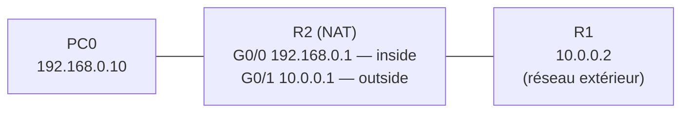

# 🛡️ Filtrage ACL et traduction d'adresses NAT/PAT

Deux TP réalisés sous **Cisco Packet Tracer** autour de la sécurité et de l'ouverture d'un réseau :

1. **« Mur de feu »** : filtrer les échanges entre plusieurs entreprises avec des **ACL** standard et étendues
2. **NAT/PAT** : permettre à un réseau privé de sortir avec une seule adresse, et publier un serveur interne

[⬅ Retour au portfolio](https://github.com/EvanBienvenu/EvanBienvenu)

## Partie 1 : filtrage par ACL (« Mur de feu »)

### Contexte

Plusieurs entreprises fictives sont reliées par des routeurs. L'entreprise **BLUE** (`192.192.1.0/24`) ne doit plus pouvoir joindre certains sites, sans que le reste du trafic soit perturbé.

| Entreprise | Réseau |
| --- | --- |
| BLUE | 192.192.1.0/24 |
| Autre réseau interne | 192.192.2.0/24 |
| ROSE (`www.rose.com`) | 201.10.10.0/24 |
| VIOLETTE | 202.20.20.0/24 |
| ÉMERAUDE | 203.30.30.0/24 |
| ORANGE | 200.200.4.0/24 |

### Scénario 1 : ACL standard

**Objectif :** bloquer BLUE vers ROSE uniquement. Une ACL standard ne regarde que la source : elle est donc placée **près de la destination**, sur Router3, en sortie vers ROSE.

```cisco
! Router3
access-list 1 deny   192.192.1.0 0.0.0.255
access-list 1 permit any
!
interface g0/1
 ip access-group 1 out
```

| Test | Résultat attendu |
| --- | --- |
| BLUE → ROSE (`ping 201.10.10.80`) | ❌ Bloqué |
| BLUE → VIOLETTE, ÉMERAUDE, ORANGE | ✅ Autorisé |
| Réseau 192.192.2.0 → ROSE | ✅ Non affecté |

### Scénario 2 : ACL étendues

**Objectif :** bloquer BLUE vers ROSE, VIOLETTE, ÉMERAUDE et ORANGE. Une ACL étendue précise la source **et** la destination : on la place **près de la source**, pour ne pas faire voyager des paquets qui seront de toute façon bloqués.

```cisco
! Router1 (proche de BLUE)
access-list 102 deny   ip 192.192.1.0 0.0.0.255 201.10.10.0 0.0.0.255
access-list 102 permit ip any any
access-list 103 deny   ip 192.192.1.0 0.0.0.255 202.20.20.0 0.0.0.255
access-list 103 permit ip any any
interface s0/0/0
 ip access-group 102 in
 ip access-group 103 out
!
! Router3
access-list 104 deny   ip 192.192.1.0 0.0.0.255 203.30.30.0 0.0.0.255
access-list 104 permit ip any any
interface g0/2
 ip access-group 104 out
!
! Router4
access-list 105 deny   ip 192.192.1.0 0.0.0.255 200.200.4.0 0.0.0.255
access-list 105 permit ip any any
interface s0/0/0
 ip access-group 105 in
```

### Méthode suivie

1. Tester la maquette **sans ACL** pour vérifier que tout communique
2. Identifier la source, la destination et le protocole à filtrer
3. Choisir le type d'ACL, le routeur, l'interface et le sens (`in` / `out`)
4. Écrire les règles précises d'abord, puis `permit any`
5. Sauvegarder (`write`), tester avec `ping`, vérifier les compteurs avec `show access-lists`

## Partie 2 : NAT/PAT

### Contexte

Le poste **PC0** est sur un réseau privé (`192.168.0.0/24`), qui ne peut pas circuler sur le réseau extérieur. Le routeur **R2** doit traduire son adresse pour qu'il puisse joindre **R1**, situé côté extérieur.



### Configuration de R2

```cisco
interface g0/0
 ip address 192.168.0.1 255.255.255.0
 ip nat inside
 no shutdown
interface g0/1
 ip address 10.0.0.1 255.255.255.0
 ip nat outside
 no shutdown
!
access-list 1 permit 192.168.0.0 0.0.0.255
ip nat inside source list 1 interface g0/1 overload
```

PC0 : adresse `192.168.0.10/24`, passerelle `192.168.0.1`.

### Tests

**`ping 10.0.0.2` depuis PC0** : réponses reçues.

**`show ip nat translations` sur R2 :**

```
Pro  Inside global   Inside local     Outside local  Outside global
icmp 10.0.0.1:1      192.168.0.10:1   10.0.0.2:1     10.0.0.2:1
```

L'adresse privée `192.168.0.10` est bien traduite en `10.0.0.1` à la sortie.

**`debug ip nat` pendant le ping :**

```
NAT: s=192.168.0.10->10.0.0.1, d=10.0.0.2
NAT*: s=10.0.0.2, d=10.0.0.1->192.168.0.10
```

La première ligne montre la traduction à l'aller, la seconde la traduction inverse au retour.

### Pour aller plus loin : NAT statique et pool d'adresses (TP 7.2.8)

Sur une topologie à trois routeurs, R2 centralise le NAT avec une **ACL nommée**, publie un **serveur web interne** et partage un **pool** de trois adresses publiques :

```cisco
ip access-list standard R2NAT
 permit 192.168.10.0 0.0.0.255
 permit 192.168.20.0 0.0.0.255
 permit 192.168.30.0 0.0.0.255
!
ip nat inside source static 192.168.20.254 209.165.202.131
ip nat pool R2POOL 209.165.202.128 209.165.202.130 netmask 255.255.255.252
ip nat inside source list R2NAT pool R2POOL overload
```

Côté fournisseur d'accès, une route vers les adresses publiques de R2 est indispensable pour que les réponses reviennent.

## Ce que j'ai appris

- L'**ordre des règles** compte : la première qui correspond s'applique
- Chaque ACL se termine par un **refus implicite** : oublier `permit any` coupe tout le réseau
- Choisir l'emplacement d'une ACL selon son type (standard près de la destination, étendue près de la source)
- Le NAT ne fonctionne qu'avec les deux déclarations `inside` et `outside`
- Lire une table de traduction et un `debug` pour prouver que le NAT fonctionne

## Compétences mobilisées

[ACL](https://github.com/EvanBienvenu/competences-reseau/blob/main/06-acl.md) · [NAT et PAT](https://github.com/EvanBienvenu/competences-reseau/blob/main/05-nat-pat.md) · [Bases de Cisco IOS](https://github.com/EvanBienvenu/competences-reseau/blob/main/01-bases-cisco-ios.md)

## 📖 Termes techniques

| Terme | Explication |
| --- | --- |
| **ACL** | Liste de règles qui autorise ou bloque des flux réseau. |
| **ACL standard** | Filtre seulement selon l'adresse source. |
| **ACL étendue** | Filtre selon la source, la destination, le protocole et le port. |
| **ACL nommée** | ACL identifiée par un nom plutôt qu'un numéro, plus lisible et modifiable règle par règle. |
| **Wildcard mask** | Masque « inversé » utilisé par Cisco dans les ACL (ex. `0.0.0.255` pour un /24). |
| **Deny implicite** | Règle invisible à la fin de chaque ACL qui bloque tout ce qui n'a pas été autorisé. |
| **in / out** | Sens d'application d'une ACL : sur le trafic qui entre dans l'interface ou qui en sort. |
| **NAT** | Traduction des adresses privées en adresse publique. |
| **PAT (overload)** | Plusieurs postes partagent une seule adresse publique, distingués par leurs ports. |
| **NAT statique** | Association fixe entre une adresse interne et une adresse publique, pour publier un serveur. |
| **Pool NAT** | Groupe d'adresses publiques que le routeur peut utiliser pour la traduction. |
| **Inside / Outside** | Côté réseau interne et côté réseau externe du routeur pour le NAT. |
| **Inside local / global** | L'adresse privée d'un poste, et l'adresse publique qu'il utilise pour sortir. |

Tous les termes sont aussi expliqués dans le [glossaire du portfolio](https://github.com/EvanBienvenu/EvanBienvenu/blob/main/GLOSSAIRE.md).
